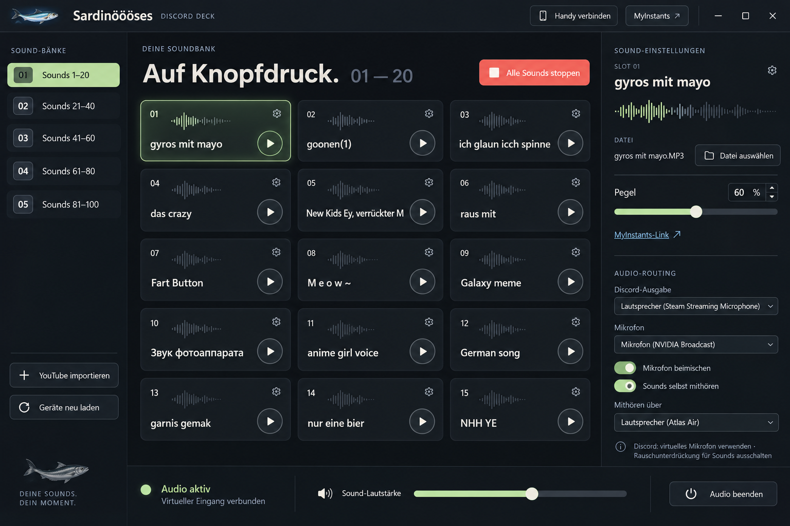

# Sardinöööses Discord Deck

Soundboard für Discord unter Windows – mit Android-App als Fernbedienung im WLAN.



## Funktionen
- 100 Sound-Plätze in 5 Bänken, Pegel pro Sound, „Alle Sounds stoppen“
- Mikrofon + Sounds werden auf ein virtuelles Mikrofon gemischt (z. B. VB-CABLE), das du in Discord als Eingang wählst
- Sounds selbst mithören über Kopfhörer
- Import von YouTube-, YouTube-Shorts- und TikTok-Audio inkl. Zuschneiden
- MyInstants-Suche
- Android-App: verbindet sich automatisch im WLAN (Kopplung per PIN), startet/stoppt Sounds
- Optional: Stream-Controller-/StreamDock-Plugin (`streamdock-plugin/`)

## Ordner
| Ordner | Inhalt |
|---|---|
| `windows/DiscordDeck` | PC-App (C#, .NET 8, WinForms, NAudio, ASP.NET-LAN-Server) |
| `windows/DiscordDeckSetup` | Ein-Datei-Installer (enthält die App als payload.zip) |
| `android` | Android-App (Java, Gradle) |
| `streamdock-plugin` | Plugin für Stream Controller / StreamDock |

## Voraussetzungen
- Windows 10/11, .NET 8 SDK
- Virtuelles Audiokabel, z. B. [VB-CABLE](https://vb-audio.com/Cable/)
- Für den Import: `yt-dlp.exe`, `ffmpeg.exe`, `ffprobe.exe`, `deno.exe` im Ordner `tools\` neben `DiscordDeck.exe` (nicht im Repo enthalten)
- Android: JDK 17+, Android SDK 35, Gradle 8.13

## Bauen
```powershell
# PC-App
dotnet publish windows\DiscordDeck\DiscordDeck.csproj -c Release -r win-x64 --self-contained true -o dist\windows
# tools\ (yt-dlp, ffmpeg, ffprobe, deno) nach dist\windows\tools kopieren, dann:
New-Item -ItemType Directory -Force windows\DiscordDeck\release | Out-Null
Compress-Archive dist\windows\* windows\DiscordDeck\release\windows-payload.zip -Force
# Installer
dotnet publish windows\DiscordDeckSetup\DiscordDeckSetup.csproj -c Release -r win-x64 --self-contained true -p:PublishSingleFile=true -o dist\setup
```
```bash
# Android (in android/)
gradle assembleRelease   # danach mit eigenem Keystore signieren
```

## Ports
TCP 47836 (Handy-Verbindung), UDP 47837 (Suche im WLAN), lokal 127.0.0.1:47835 (API). Der Installer legt bei Bedarf Firewall-Regeln an.
