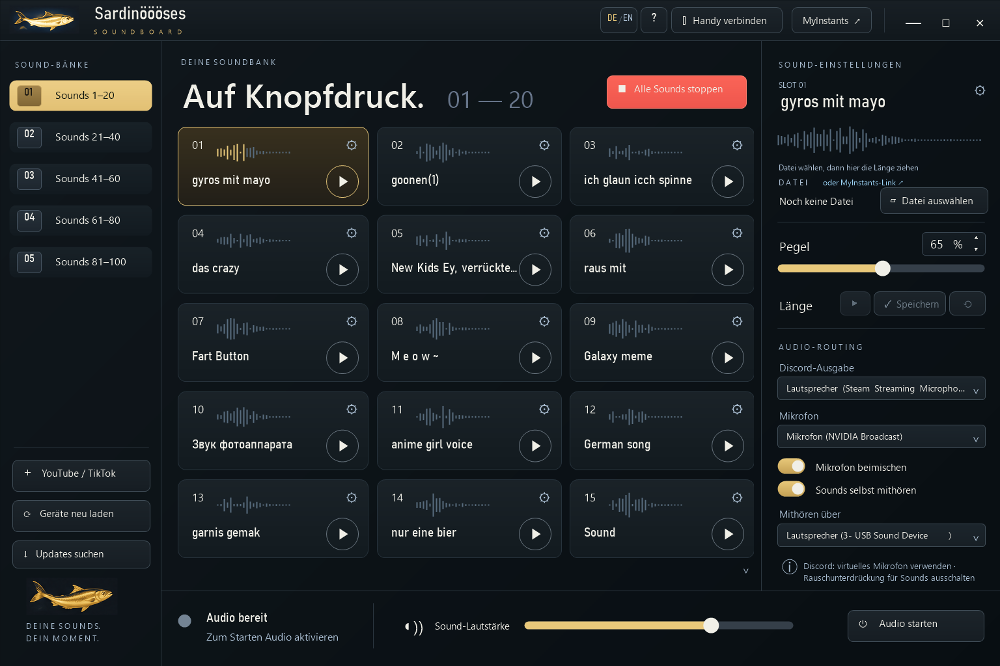

# Sardinöööses Soundboard · SSB

<a href="https://github.com/rasy420/sardinoeoeoeses-soundboard/releases/latest/download/SSB-Setup.exe"></a>

**[⬇ Kompletten Windows-Installer herunterladen](https://github.com/rasy420/sardinoeoeoeses-soundboard/releases/latest/download/SSB-Setup.exe)** · **[Android-App herunterladen](https://github.com/rasy420/sardinoeoeoeses-soundboard/releases/latest/download/SSB-Android.apk)**

Windows 10/11 (64 Bit). Der Installer enthält .NET-Laufzeit, Audio-Bibliotheken, yt-dlp, FFmpeg/FFprobe, Deno und Android-App. Kein SDK erforderlich. Fehlt ein virtuelles Audiogerät, lädt das Setup den signaturgeprüften originalen VB-CABLE-Installer vom Hersteller und startet dessen automatische Installation. Windows fragt für Treiber und Firewall nach Administratorrechten; zusätzliche Windows-Treiberabfragen müssen bestätigt werden. Ein Neustart kann erforderlich sein.

Neue Funktionen: Gold-Design, Deutsch/Englisch (DE / EN), Einführung beim ersten Öffnen und erneut über ?, Schnittmarker mit Mausbedienung, Vorhören und Speichern. Android enthält eine eigene Kurzanleitung. Die Update-Funktion unten links und im Infobereich lädt das neueste stabile GitHub-Release, prüft SHA-256 und öffnet den Installer. Sounds und Einstellungen bleiben erhalten.

 **Android 1.4.5:** Oben ein kleiner Knopf **Bearbeiten**. Eine von zehn Farben wählen, dann Kacheln antippen. Nur der Rand wird farbig, die Fläche bleibt dunkel. Dieselbe Farbe nochmal entfernt den Rand. Die Farben bleiben auf dem Handy gespeichert. Die PC-App bleibt bei 1.4.7.

Ein Klick auf einen freien Soundplatz öffnet die Einstellungen nicht. Dafür ist das Zahnrad auf der Kachel da, auch wenn der Platz leer ist.

**Neu in 1.4.8:** Alle 100 Sounds bilden eine durchgehende, weich scrollbare Wand; die goldene Bank links wechselt beim Scrollen mit, ein Bankklick scrollt dorthin. Audio starten pulsiert, bis Audio läuft. Der YouTube/TikTok-Knopf ist rot und weiß. Handy verbinden ist hervorgehoben, solange noch nie ein Handy verbunden war. Neue Sounds auf freien Plätzen starten mit 150 % Lautstärke. Android 1.4.6 hat statt des Stopps auf der Kachel oben einen roten Knopf Alle Sounds stoppen; jedes Antippen spielt den Sound erneut.

**Neu in 1.4.4:** Android zeigt oben ein kleines goldenes **?**. Jede spielende Kachel zeigt einen roten **Stopp**-Knopf, der nur diesen Sound beendet. Der globale Stoppen-Knopf entfällt auf Android. Die Anzeige folgt der echten PC-Wiedergabe, auch nach Hintergrundpausen und Umsortieren. PC und Android benötigen beide 1.4.4. Kopplungen und Einstellungen bleiben erhalten. Nach PC-Updates öffnet sich das Programm sichtbar. Sound-Einstellungen liegen als rechtes Overlay über den Kacheln, ohne deren Position oder Größe zu verändern. Ein Klick auf Titel, Zwischenräume oder Kacheln schließt es; offene Änderungen müssen zuerst gespeichert werden. Der YouTube-/TikTok-Import zeigt eine echte Wellenform mit ziehbaren goldenen Start-/Endmarkern, direktem Vorhören und Speichern des gewählten MP3-Ausschnitts. Bankname und Bereich stehen neben dem Titel, der untere Regler heißt Gesamtlautstärke und das Schließen-X der Seitenleiste ist rot markiert.

**Neu in 1.4.3:** **Bearbeiten** unter dem roten Stoppen-Knopf schaltet den Bearbeitungsmodus ein. Dann lassen sich einzelne Sounds und ganze Bänke verschieben. Nur in diesem Modus erscheinen Stifte zum Umbenennen der Bänke; **Fertig** beendet den Modus. Alle fünf Bänke und 100 Soundplätze bleiben erhalten. Beim Kachelklick klappt die Sound-Bearbeitung zu. Falls Änderungen offen sind, muss zuerst über den goldenen Speichern-Knopf gespeichert werden; vorher wird der Kachelklick blockiert.

**Neu in 1.4.2:** Ein Stiftsymbol neben der Banknummer oberhalb der Kacheln schaltet Umsortieren ein und aus. Alle Sounds stoppen steht unter den fünf Bänken. Leere Slots zeigen keine zufällige Wellenform mehr. Die Tour-Markierungen folgen dem aktuellen Layout, der sichtbaren Kachel und der Breite des Soundbereichs.

**Neu in 1.4.1:** Die Installation über den Update-Knopf ist repariert. Das Setup gibt sein geerbtes Arbeitsverzeichnis frei, bevor es den Programmordner austauscht. Falls ein 1.4.0-Setup noch mit einer Dateisperre offen ist, dieses Fenster zuerst schließen und den aktuellen Installer starten.

**Neu in 1.4.0:** Die ganze Soundkachel spielt ab; das Zahnrad öffnet ausschließlich die Bearbeitung. Die Seitenleiste startet geschlossen und lässt sich per X schließen. Der Soundbereich nutzt dann die freie Breite. Gold markiert nur tatsächlich spielende Sounds. **Umsortieren** bleibt erhalten, auch zwischen Bänken und mit automatischer Übernahme auf dem Handy.

Der Stift ändert den Anzeigenamen unabhängig vom Dateinamen. Start, Ende und Pegel sind Entwürfe; **Speichern** übernimmt sie zusammen, **Zurücksetzen** lädt die zuletzt gespeicherten Werte. Beim Schließen oder Wechseln erscheinen Speichern, Verwerfen und Abbrechen. **Sound ersetzen** bietet eine Audiodatei oder einen MyInstants-Link; der Mülleimer leert nur den bearbeiteten Slot und erhält Originaldateien. **Audio-Einstellungen** unten rechts öffnet das globale Routing.

Die PC-App prüft beim Start und alle zehn Minuten nach Updates. Normalerweise steht unten links **Auf dem neuesten Stand**; bei einer neuen Version erscheint golden pulsierend **Updates installieren**. Der Tray bietet weiterhin eine manuelle Prüfung. Die Beschriftung **Von YouTube / TikTok importieren**, Abstände und ein gezeichnetes Handy-Icon wurden angepasst. Instagram ist nicht enthalten.

**Neu in 1.3.0:** Oben über den Sounds **Umsortieren** anklicken, einen Sound an die gewünschte Position ziehen und loslassen. Andere Sounds rücken nach; Datei, Pegel und Schnittbereich bleiben zusammen. Während des Ziehens über einer Bank links halten, um die Bank zu wechseln; am oberen/unteren Rand scrollt die Liste. Mit **Fertig** den Modus beenden. Die Handy-App übernimmt die Reihenfolge beim nächsten Abruf automatisch, auch mit einer älteren APK.

Android ab 1.3.0 blendet verfügbare App-Updates oben ein. **Herunterladen** startet den Download, **Installieren** öffnet nach Prüfung von SHA-256, Paketname und Signatur die Android-Installation. Android verlangt dafür einmal die Erlaubnis „Unbekannte Apps installieren“ und bei jedem Update eine Bestätigung. Bestehende ältere APKs müssen einmal manuell aktualisiert werden, um diesen Hinweis zu erhalten.

Die Soundnamen im Bild sind Beispiele. Neue Installationen enthalten **keine vorbelegten Sounds und keine Audiodateien**.

Soundboard für Discord unter Windows – mit Android-App als Fernbedienung im WLAN.



## Funktionen
- 100 Sound-Plätze in 5 Bänken, Pegel pro Sound, „Alle Sounds stoppen“
- Mikrofon + Sounds werden auf ein virtuelles Mikrofon gemischt (z. B. VB-CABLE), das du in Discord als Eingang wählst
- Sounds selbst mithören über Kopfhörer
- Import von YouTube-, YouTube-Shorts- und TikTok-Audio inkl. Zuschneiden
- MyInstants-Suche
- Android-App: verbindet sich automatisch im WLAN (Kopplung per PIN), startet/stoppt Sounds
- Optional: Stream-Controller-/StreamDock-Plugin (`streamdock-plugin/`)

## Ordner
| Ordner | Inhalt |
|---|---|
| `windows/DiscordDeck` | PC-App (C#, .NET 8, WinForms, NAudio, ASP.NET-LAN-Server) |
| `windows/DiscordDeckSetup` | Ein-Datei-Installer (enthält die App als payload.zip) |
| `android` | Android-App (Java, Gradle) |
| `streamdock-plugin` | Plugin für Stream Controller / StreamDock |

## Voraussetzungen für Entwickler (im Installer bereits enthalten)
- Windows 10/11, .NET 8 SDK
- Virtuelles Audiokabel, z. B. [VB-CABLE](https://vb-audio.com/Cable/)
- Für den Import: `yt-dlp.exe`, `ffmpeg.exe`, `ffprobe.exe`, `deno.exe` im Ordner `tools\` neben `DiscordDeck.exe` (nicht im Repo enthalten)
- Android: JDK 17+, Android SDK 35, Gradle 8.13

## Bauen
```powershell
# PC-App
dotnet publish windows\DiscordDeck\DiscordDeck.csproj -c Release -r win-x64 --self-contained true -o dist\windows
# tools\ (yt-dlp, ffmpeg, ffprobe, deno) nach dist\windows\tools kopieren, dann:
New-Item -ItemType Directory -Force windows\DiscordDeck\release | Out-Null
Compress-Archive dist\windows\* windows\DiscordDeck\release\windows-payload.zip -Force
# Installer
dotnet publish windows\DiscordDeckSetup\DiscordDeckSetup.csproj -c Release -r win-x64 --self-contained true -p:PublishSingleFile=true -o dist\setup
```
```bash
# Android (in android/)
gradle assembleRelease   # danach mit eigenem Keystore signieren
```

## Ports
TCP 47836 (Handy-Verbindung), UDP 47837 (Suche im WLAN), lokal 127.0.0.1:47835 (API). Der Installer legt bei Bedarf Firewall-Regeln an.

## Updates veröffentlichen

Stabiles Release mit Tag `vMAJOR.MINOR.PATCH` erstellen. Installer immer **SSB-Setup.exe**, Android-App **SSB-Android.apk** nennen. Windows-Assembly-Version anpassen. Der Updater verlangt die SHA-256-Prüfsumme, die GitHub für das Release-Asset liefert. Drafts und Vorabversionen werden ignoriert.

Für Android zusätzlich **SSB-Android-update.json** veröffentlichen, z. B. `{"versionCode":8,"versionName":"1.3.0","sha256":"SHA256_DER_SIGNIERTEN_APK"}`. Den Android-versionCode bei jedem Android-Update erhöhen und denselben Signierschlüssel behalten. Bei reinen PC-Updates dürfen APK und Android-Metadaten gleich bleiben: das Handy bietet dann kein unnötiges Update an.

## Prüfen

`--sound-settings-test`, `--reorder-test`, `--update-test`, `--trim-test`, `--tour-test`, `--ui-test`, `--design-test`, `--lan-test`, `--gain-test`, `--import-test`. `DISCORDDECK_HOME` auf einen leeren Testordner setzen. Testfenster starten keine normalen Server; LAN-Prüfungen verwenden TCP 47846 / UDP 47847. JSON-Ergebnisse auf `ok` prüfen. Die Sound-Einstellungsprüfung testet Umbenennen, Ersetzen, Sekundenfelder, Speicherung, Fehlerfälle und kleine Fenster. Der Reorder-Test prüft Mausbedienung, Speichern, Neustart, Fehlerfälle und die Reihenfolge über echte LAN-Abfragen.

Android-Updater-Kern ohne Handy prüfen: `javac -d test-classes app/src/main/java/de/cocoa/discorddeck/UpdateInfo.java tests/UpdateInfoTest.java`, danach `java -cp test-classes de.cocoa.discorddeck.UpdateInfoTest` im Android-Ordner. Der DownloadManager und die Android-Installation müssen zusätzlich auf einem Gerät geprüft werden.
